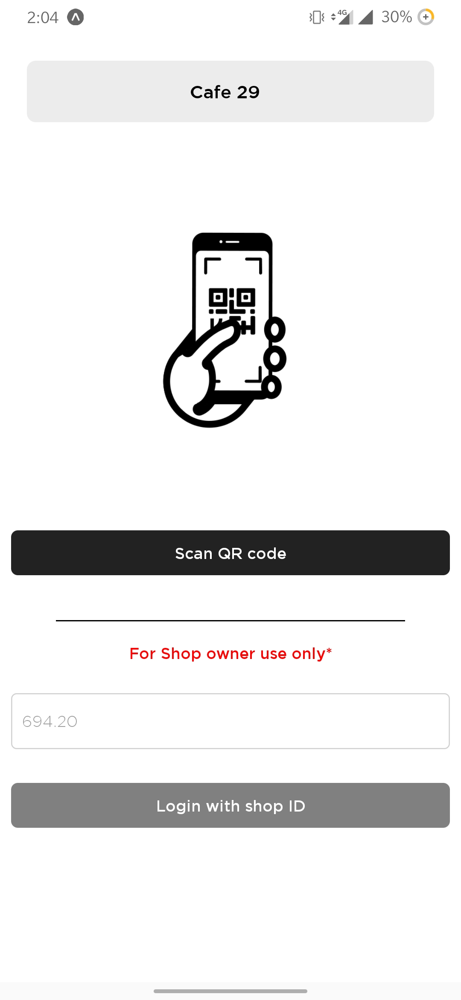
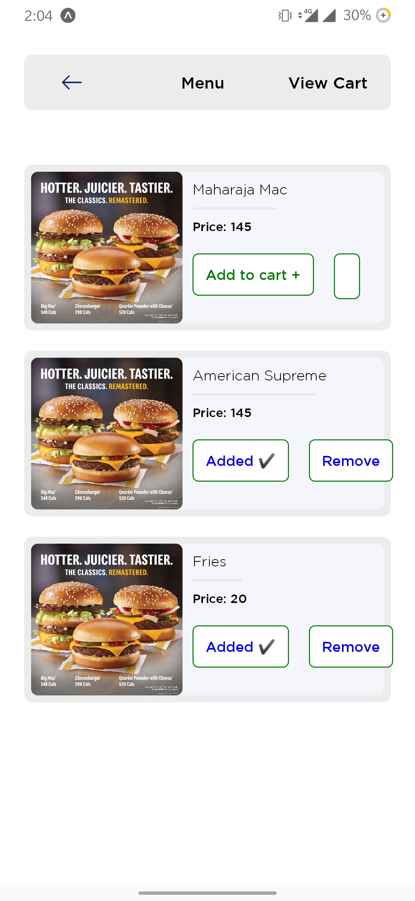
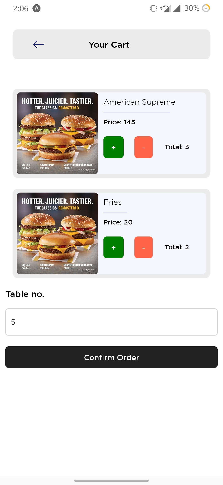
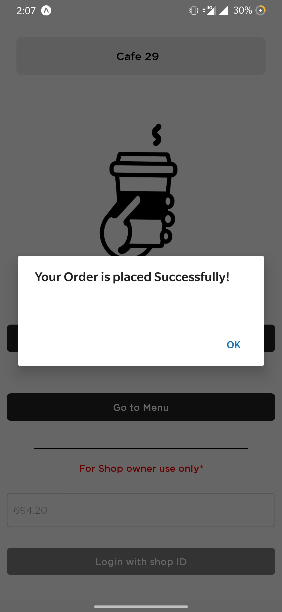
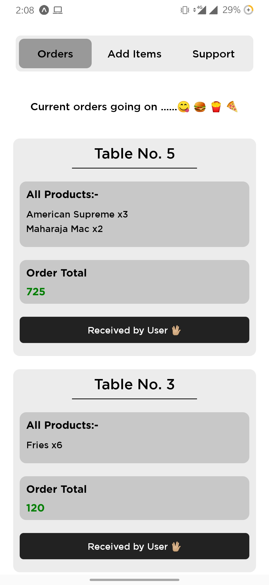
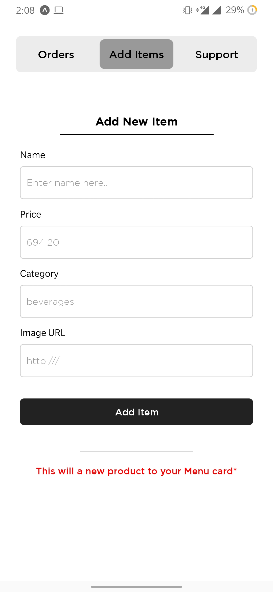

<div align="center">

# Contactless Menu

Scan a QR code on the table, browse the menu and order without touching a paper menu.

    

</div>

<table>
  <tr><th>Scan</th><th>Menu</th><th>Cart</th></tr>
  <tr><td></td><td></td><td></td></tr>
</table>

## About

Contactless Menu is a mobile app for restaurants, built during a hackathon. Every restaurant gets its own QR code. A customer scans the code on their table, browses that restaurant's menu, adds items to a cart and places the order for their table number. The restaurant owner logs in with their restaurant ID to see live orders for each table, add new dishes to the menu and contact support.

## Screenshots

| Order placed | Owner: live orders | Owner: add item |
| :---: | :---: | :---: |
|  |  |  |

## Features

**For customers**

- Scan the restaurant's QR code to open its menu
- Add and remove items, change quantities and see the running total
- Enter the table number and place the order

**For restaurant owners**

- Log in with a restaurant ID
- See current orders grouped by table, with the items and order total
- Mark an order as received once it is served
- Add new items (name, price, category and image URL) to the menu

## Tech Stack

| Area | Technology |
| --- | --- |
| Mobile app | React Native, Expo SDK 40, Expo Barcode Scanner |
| Backend | Node.js, Express, Helmet, Morgan |
| Database | MongoDB with Mongoose |

## API

| Method | Endpoint | Description |
| --- | --- | --- |
| `GET` | `/getMenu/:id` | Menu items for a restaurant |
| `POST` | `/placeOrder` | Place an order for a table |
| `GET` | `/getOrders/:id` | Current orders for a restaurant |
| `DELETE` | `/deleteOrder/:id` | Remove an order once it is served |
| `GET` | `/login/:id` | Restaurant owner login |
| `POST` | `/addItem` | Add an item to the menu |

## Getting Started

**Prerequisites:** Node.js, the Expo CLI, a MongoDB database, and the Expo Go app on your phone

### 1. Start the server

```bash
cd server
npm install
MONGODB_URI="<your MongoDB connection string>" node index.js
```

The server listens on port `3000`, or on `PORT` if it is set.

### 2. Start the app

Point `client/HttpLink.js` at your server's URL, then run:

```bash
cd client
npm install
npm start
```

Scan the QR code from the Expo CLI with the Expo Go app.

### Environment variables

| Variable | Description |
| --- | --- |
| `MONGODB_URI` | MongoDB connection string used by the server |
| `PORT` | Server port (default `3000`) |

## Project Structure

```
.
├── client/            # React Native (Expo) app
│   ├── screens/       # Home (scan), Menu, Cart and Owner screens
│   ├── assets/        # images, fonts and README screenshots
│   └── HttpLink.js    # server URL used by the app
└── server/            # Express + MongoDB API
    └── index.js
```
